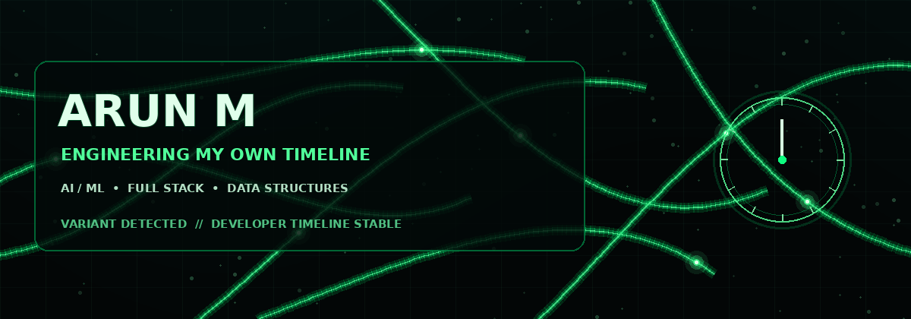

<h3>⚡ Welcome to my branch of the multiverse ⚡</h3>

  <b>Final-year B.Tech AI & Data Science student</b> at St. Joseph's Institute of Technology, Chennai 
  Full Stack Developer · AI/ML Engineer · Problem Solver

---

## `01 // VARIANT PROFILE`

> *Every choice creates a branch. I build the tools that help turn ideas into reality.*

I'm Arun, a final-year **Artificial Intelligence and Data Science** student who enjoys building full-stack products and AI-powered applications. My work spans civic-tech, EdTech, and developer-focused AI tools — from classifying civic complaints to creating voice-driven mock interviews.

- 🎓 **Degree:** B.Tech — Artificial Intelligence & Data Science
- 🏫 **College:** St. Joseph's Institute of Technology, Chennai
- 📊 **CGPA:** 8.21 / 10
- 🧠 **Problem solving:** 320+ LeetCode problems
- 🛠️ **Experience:** Software Development and Web Development internships
- 🌿 **Current mission:** Building useful products with clean engineering and intelligent systems

## `02 // TVA TECH ARCHIVES`

  

### Languages & Frameworks

  
  
  
  
  
  
  

### AI / ML, Data & Infrastructure

  
  
  
  
  
  
  
  
  

## `03 // SIGNIFICANT TIMELINE BRANCHES`

### 🟢 CivicFlow — AI Civic Complaint Platform
**React.js · Flask · SQLite · CNN · Random Forest**

- Built a full-stack civic complaint platform designed for all **38 districts of Tamil Nadu**.
- Used a CNN-based image classifier to automatically categorize and route complaints, reducing manual triage effort by **90%**.
- Built a Random Forest model to estimate resolution timelines and flag repair quotes above ₹500 as potential overcharges.

[↗ Explore CivicFlow AI](https://github.com/Arun597134/CivicflowAI)

### 🟢 HireWise — AI Voice Mock Interviewer
**Python · Mistral AI API · PyMuPDF · Speech pipelines**

- Built an AI interview simulator that parses resumes and generates role-specific interview questions.
- Integrated real-time speech-to-text and text-to-speech for a hands-free mock interview experience.

[↗ Explore HireWise](https://github.com/AjayJ19/HireWise-AI)

### 🟢 AI Online Assessment Platform
**MERN · TensorFlow.js · AI-generated MCQs**

- Developed an exam platform with timed auto-submission and role-based access for admins and students.
- Created a client-side proctoring module that detects face absence and tab switching.

[↗ Explore AI Exam Portal](https://github.com/Arun597134/AI-Exam-portal)

## `04 // FIELD EXPERIENCE`

**Software Development Intern — Prodigy Infotech** · *Jul 2025 – Aug 2025*
- Built a reusable React component library used across 3+ product feature areas.
- Diagnosed and resolved 10+ production bugs through a peer-reviewed CI/CD pipeline.

**Web Development Intern — Codtech IT Solutions** · *Oct 2024 – Jan 2025*
- Shipped 3 responsive web pages integrated with live backend APIs for a client-facing product.

## `05 // ACHIEVEMENT VAULT`

- 🧩 **320+** LeetCode problems solved across arrays, strings, trees, graphs, and dynamic programming.
- 🏅 **9+ certifications**, including Elite NPTEL certifications from IIT Madras.
- 🌐 Selected as a **MyGov Campus Ambassador** for digital governance initiatives.
- 🤝 Mentored 11th- and 12th-grade students in AI/ML and Generative AI.

**Selected certifications**
- Python for Data Science — NPTEL (Elite)
- Database Management Systems — NPTEL (Elite)
- Getting Started with Deep Learning — NVIDIA
- Introduction to Generative AI — Google Cloud
- OCI AI Foundations — Oracle
- Front End Web Development — Infosys Springboard
- Basics of MongoDB — MongoDB University

## `06 // LIVE TELEMETRY`

 

## `07 // OPEN A PORTAL`

 

⏳ KEEP THE TIMELINE STABLE. KEEP BUILDING. ⏳

---

  Visual theme: TVA control-room atmosphere, emerald timeline branches, and multiverse time-dial motifs — an original Loki-inspired fan aesthetic.

