"""Run this ONE script inside your Arun597134/Arun597134 repo folder:
    python setup_profile.py
It creates README.md, assets/*.svg and .github/workflows/snake.yml."""
import os

FILES = {}
FILES['README.md'] = '
\n\n<!-- Animated header (local SVG: stars, glow orbs, gradient name, waves) -->\n\n\n<!-- Typing SVG -->\n\n\n \n\n<!-- Social Badges -->\n\n\n\n\n\n  \n\n\n\n\n\n\n
\n\n\n\n## 🧠 About Me\n\n👋 &nbsp;Hey! I\'m **Arun M** — a passionate **Full Stack Developer** and **AI/ML Engineer** from Chennai, India 🇮🇳\n\n🎓 &nbsp;Pursuing **B.Tech in AI & Data Science** at St. Joseph\'s Institute of Technology &nbsp;`CGPA: 8.21 / 10`\n\n🚀 &nbsp;Currently building a **MERN Learning Management System** with role-based access & AI integration\n\n🤖 &nbsp;I love crafting intelligent systems — from NLP pipelines to real-time proctoring engines\n\n💡 &nbsp;Fun fact: *I make machines learn so I don\'t have to!*\n\n \n\n\n\n\n\n\n\n\n \n\n

\n\n## 🛠️ Tech Arsenal\n\n
\n\n<!-- Scrolling skills marquee -->\n\n\n \n\n\n\n  \n\n\n\n\n\n\n\n\n\n\n\n\n
\n\n## 🚀 Featured Projects\n\n<table>\n<tr>\n<td width="50%" valign="top">\n\n### 🤖 [HireWise AI — Mock Interviewer](https://github.com/Arun597134/Hirewise-AI)\n\n\n\n> AI-powered interview simulator with NLP resume parsing\n\n\n\n\n\n\n- 📄 NLP resume parsing & keyword extraction\n- ❓ 20+ tailored questions per session\n- 📈 **40% boost** in question relevance\n- 🔄 End-to-end automated interview flow\n\n</td>\n<td width="50%" valign="top">\n\n### 🎓 [AI Assessment Platform](https://github.com/arunvijay/assessment-platform)\n\n\n\n> Full-stack exam platform with AI proctoring\n\n\n\n\n\n\n- 📷 Webcam proctoring via TensorFlow.js\n- 🚫 Tab-switch tracking & fullscreen lock\n- 📊 Real-time integrity scores\n- 🏆 Leaderboard & analytics dashboard\n\n</td>\n</tr>\n<tr>\n<td colspan="2" valign="top">\n\n### 📚 MERN Learning Management System *(In Development 🔨)*\n\n\n\n> Full-stack LMS with role-based access and AI-proxied ML services\n\n\n\n\n\n\n\n\n- 🔐 JWT auth + bcrypt + refresh token sessions\n- 👥 Roles: **Student**, **Instructor**, **Admin**\n- 📹 Per-session video progress tracking\n- 🔍 Search, domain filtering & paginated listings\n- 📝 Timestamped notes & session bookmarks\n- 🤖 AI/ML services proxied through backend\n\n \n</td>\n</tr>\n<tr>\n<td colspan="2" valign="top">\n\n### 🏛️ [CivicFlow — AI Civic Complaint Platform](https://github.com/Arun597134/)\n\n\n\n> AI-powered municipal complaint management platform for Tamil Nadu citizens & administrators\n\n\n\n\n\n\n\n\n**🤖 AI & ML Core**\n- 👁️ AI Vision module parses complaint images → auto-routes to correct dept (Public Works / Sanitation)\n- ⏱️ ML delay prediction model estimates resolution time from category + historical data\n- 💰 Anti-corruption cost estimation — caps base repair estimates at ₹500 for transparency\n\n**🗺️ Hyper-Local Operations**\n- 📍 All **38 Tamil Nadu districts** mapped down to town/village level\n- 🚗 Ola-style live dashboard for real-time officer assignment by geo-location\n- 📡 Citizens track assigned officer & operational status live\n\n**🌍 Citizen Empowerment**\n- 🌐 Tamil language localization via global translation widget\n- ✅ Full CRUD — citizens own, track & delete their complaints\n- 🔐 JWT-secured separate portals for Citizens & Administrators\n\n \n</td>\n</tr>\n<tr>\n<td colspan="2" valign="top">\n\n### 🏗️ Enterprise Data Ingestion & Validation Framework &nbsp;\n\n> Hybrid batch + streaming ingestion framework with SQL-pushdown validation and automated monitoring\n\n\n\n\n\n\n\n- 🔀 Hybrid **batch + streaming** ingestion using Airflow & Kafka\n- ✅ **SQL-pushdown validation** — checks run inside PostgreSQL, not in Python memory\n- 📡 Automated monitoring for pipeline health & data quality\n- ⚡ **36× reduction in memory usage**\n\n</td>\n</tr>\n</table>\n\n

\n\n## 💼 Experience\n\n
\n\n### 🟣 &nbsp;Prodigy Infotech &nbsp;—&nbsp;  &nbsp; \n\n\n\n\n\n\n### 🔵 &nbsp;Codtech IT Solutions &nbsp;—&nbsp;  &nbsp; \n\n\n\n\n\n### 🟠 &nbsp;Codsoft IT Solutions &nbsp;—&nbsp;  &nbsp; \n\n\n\n\n\n\n\n
\n\n## 🏆 Certifications\n\n| 🎖️ Certificate | 🏫 Issuer | 🛠️ Topics |\n|:---|:---:|:---|\n| Front End Web Developer |  | HTML · CSS · JS · Responsive Design |\n| Basics of MongoDB |  | NoSQL · Collections · Queries |\n| OCI AI Foundations |  | Cloud Infrastructure · AI Services |\n| Intro to Large Language Models |  | LLM Concepts · Prompt Engineering |\n| Intro to Generative AI |  | GenAI · Foundation Models |\n\n

\n\n## 📊 GitHub Stats\n\n
\n\n\n&nbsp;\n\n\n \n\n\n\n \n\n\n\n
\n\n

\n\n## 📈 Contribution Graph\n\n
\n\n<!-- 🐍 Snake eats your contributions. Generated by .github/workflows/snake.yml -->\n<picture>\n  <source media="(prefers-color-scheme: dark)" srcset="https://raw.githubusercontent.com/Arun597134/Arun597134/output/github-snake-dark.svg" />\n  <source media="(prefers-color-scheme: light)" srcset="https://raw.githubusercontent.com/Arun597134/Arun597134/output/github-snake.svg" />\n  \n</picture>\n\n  \n\n\n\n
\n\n

\n\n
\n\n### *Let\'s connect and build something impactful!*\n\n\n\n\n\n \n\n### 😂 Me waiting for my PR to get approved...\n\n\n\n \n\n### 🐛 Also me after fixing one bug and creating three more...\n\n\n\n  \n\n> *"It works on my machine"* — Arun M, probably 🤷\u200d♂️\n\n \n\n\n\n
\n'
FILES['.github/workflows/snake.yml'] = 'name: Generate Contribution Snake\n\non:\n  schedule:\n    - cron: "0 */12 * * *"\n  workflow_dispatch:\n  push:\n    branches:\n      - main\n\npermissions:\n  contents: write\n\njobs:\n  generate:\n    runs-on: ubuntu-latest\n    timeout-minutes: 10\n    steps:\n      - name: Generate snake from contribution graph\n        uses: Platane/snk/svg-only@v3\n        with:\n          github_user_name: ${{ github.repository_owner }}\n          outputs: |\n            dist/github-snake.svg\n            dist/github-snake-dark.svg?palette=github-dark\n\n      - name: Push to output branch\n        uses: crazy-max/ghaction-github-pages@v3.1.0\n        with:\n          target_branch: output\n          build_dir: dist\n        env:\n          GITHUB_TOKEN: ${{ secrets.GITHUB_TOKEN }}\n'
FILES['assets/header.svg'] = '<svg xmlns="http://www.w3.org/2000/svg" width="1000" height="260" viewBox="0 0 1000 260">\n  <defs>\n    <linearGradient id="bg" x1="0" y1="0" x2="1" y2="1">\n      <stop offset="0" stop-color="#0D0D1A"/>\n      <stop offset="0.35" stop-color="#1a0533"/>\n      <stop offset="0.7" stop-color="#0d1b4b"/>\n      <stop offset="1" stop-color="#0D0D1A"/>\n    </linearGradient>\n    <linearGradient id="txt" gradientUnits="userSpaceOnUse" x1="0" y1="0" x2="500" y2="0">\n      <stop offset="0" stop-color="#a855f7"/>\n      <stop offset="0.5" stop-color="#38bdf8"/>\n      <stop offset="1" stop-color="#a855f7"/>\n      <animateTransform attributeName="gradientTransform" type="translate" from="-500 0" to="500 0" dur="5s" repeatCount="indefinite"/>\n    </linearGradient>\n    <linearGradient id="wave1" x1="0" y1="0" x2="1" y2="0">\n      <stop offset="0" stop-color="#7c3aed" stop-opacity="0.55"/>\n      <stop offset="1" stop-color="#0ea5e9" stop-opacity="0.35"/>\n    </linearGradient>\n    <radialGradient id="glow" cx="0.5" cy="0.5" r="0.5">\n      <stop offset="0" stop-color="#a855f7" stop-opacity="0.45"/>\n      <stop offset="1" stop-color="#a855f7" stop-opacity="0"/>\n    </radialGradient>\n    <filter id="blur"><feGaussianBlur stdDeviation="2"/></filter>\n  </defs>\n\n  <rect width="1000" height="260" fill="url(#bg)"/>\n\n  <!-- pulsing glow orbs -->\n  <circle cx="200" cy="90" r="140" fill="url(#glow)">\n    <animate attributeName="r" values="120;170;120" dur="6s" repeatCount="indefinite"/>\n  </circle>\n  <circle cx="820" cy="150" r="150" fill="url(#glow)">\n    <animate attributeName="r" values="160;110;160" dur="7s" repeatCount="indefinite"/>\n  </circle>\n\n  <!-- twinkling stars -->\n  <g fill="#ffffff">\n    <circle cx="60" cy="40" r="1.6"><animate attributeName="opacity" values="0.1;1;0.1" dur="2.1s" repeatCount="indefinite"/></circle>\n    <circle cx="150" cy="190" r="1.2"><animate attributeName="opacity" values="1;0.1;1" dur="3s" repeatCount="indefinite"/></circle>\n    <circle cx="260" cy="30" r="1.8"><animate attributeName="opacity" values="0.2;1;0.2" dur="2.6s" repeatCount="indefinite"/></circle>\n    <circle cx="380" cy="215" r="1.3"><animate attributeName="opacity" values="0.1;0.9;0.1" dur="3.4s" repeatCount="indefinite"/></circle>\n    <circle cx="470" cy="25" r="1.5"><animate attributeName="opacity" values="1;0.2;1" dur="2.3s" repeatCount="indefinite"/></circle>\n    <circle cx="590" cy="200" r="1.7"><animate attributeName="opacity" values="0.2;1;0.2" dur="2.9s" repeatCount="indefinite"/></circle>\n    <circle cx="700" cy="45" r="1.4"><animate attributeName="opacity" values="0.1;1;0.1" dur="2.4s" repeatCount="indefinite"/></circle>\n    <circle cx="790" cy="225" r="1.2"><animate attributeName="opacity" values="1;0.1;1" dur="3.2s" repeatCount="indefinite"/></circle>\n    <circle cx="880" cy="35" r="1.9"><animate attributeName="opacity" values="0.2;1;0.2" dur="2.0s" repeatCount="indefinite"/></circle>\n    <circle cx="950" cy="120" r="1.3"><animate attributeName="opacity" values="0.1;0.9;0.1" dur="3.6s" repeatCount="indefinite"/></circle>\n    <circle cx="30" cy="130" r="1.1"><animate attributeName="opacity" values="1;0.2;1" dur="2.8s" repeatCount="indefinite"/></circle>\n  </g>\n\n  <!-- floating code symbols -->\n  <g font-family="\'Courier New\',monospace" font-size="22" fill="#a855f7" opacity="0.5">\n    <text x="90" y="120">&lt;/&gt;<animateTransform attributeName="transform" type="translate" values="0 0;0 -14;0 0" dur="4s" repeatCount="indefinite"/></text>\n    <text x="880" y="90">{ }<animateTransform attributeName="transform" type="translate" values="0 0;0 12;0 0" dur="5s" repeatCount="indefinite"/></text>\n    <text x="760" y="200" fill="#38bdf8">AI<animateTransform attributeName="transform" type="translate" values="0 0;0 -10;0 0" dur="4.5s" repeatCount="indefinite"/></text>\n    <text x="140" y="210" fill="#38bdf8">01<animateTransform attributeName="transform" type="translate" values="0 0;0 10;0 0" dur="3.8s" repeatCount="indefinite"/></text>\n  </g>\n\n  <!-- name -->\n  <text x="500" y="125" text-anchor="middle" font-family="\'Segoe UI\',Verdana,sans-serif" font-size="82" font-weight="800" fill="url(#txt)" letter-spacing="2">Arun M\n    <animate attributeName="opacity" values="0;1" dur="1.2s" fill="freeze"/>\n  </text>\n\n  <!-- subtitle -->\n  <text x="500" y="168" text-anchor="middle" font-family="\'Segoe UI\',Verdana,sans-serif" font-size="24" fill="#e2e8f0" letter-spacing="3">Full Stack Developer  |  AI / ML Engineer\n    <animate attributeName="opacity" values="0;0;1" keyTimes="0;0.4;1" dur="2s" fill="freeze"/>\n  </text>\n\n  <!-- underline sweep -->\n  <rect x="380" y="182" width="240" height="3" rx="1.5" fill="#a855f7">\n    <animate attributeName="width" values="0;240;240" keyTimes="0;0.5;1" dur="2.5s" fill="freeze"/>\n    <animate attributeName="x" values="500;380;380" keyTimes="0;0.5;1" dur="2.5s" fill="freeze"/>\n  </rect>\n\n  <!-- waves -->\n  <path fill="url(#wave1)" d="M0 220 C150 190 300 250 500 220 C700 190 850 250 1000 220 L1000 260 L0 260 Z">\n    <animate attributeName="d" dur="7s" repeatCount="indefinite"\n      values="M0 220 C150 190 300 250 500 220 C700 190 850 250 1000 220 L1000 260 L0 260 Z;\n              M0 225 C150 250 300 190 500 225 C700 250 850 190 1000 225 L1000 260 L0 260 Z;\n              M0 220 C150 190 300 250 500 220 C700 190 850 250 1000 220 L1000 260 L0 260 Z"/>\n  </path>\n  <path fill="#7c3aed" fill-opacity="0.3" d="M0 235 C200 215 350 255 500 235 C650 215 800 255 1000 235 L1000 260 L0 260 Z">\n    <animate attributeName="d" dur="5s" repeatCount="indefinite"\n      values="M0 235 C200 215 350 255 500 235 C650 215 800 255 1000 235 L1000 260 L0 260 Z;\n              M0 238 C200 255 350 215 500 238 C650 255 800 215 1000 238 L1000 260 L0 260 Z;\n              M0 235 C200 215 350 255 500 235 C650 215 800 255 1000 235 L1000 260 L0 260 Z"/>\n  </path>\n</svg>\n'
FILES['assets/marquee.svg'] = '<svg xmlns="http://www.w3.org/2000/svg" width="1000" height="70" viewBox="0 0 1000 70">\n  <defs>\n    <clipPath id="c"><rect width="1000" height="70" rx="12"/></clipPath>\n    <linearGradient id="fade" x1="0" y1="0" x2="1" y2="0">\n      <stop offset="0" stop-color="#0D0D1A" stop-opacity="1"/>\n      <stop offset="0.08" stop-color="#0D0D1A" stop-opacity="0"/>\n      <stop offset="0.92" stop-color="#0D0D1A" stop-opacity="0"/>\n      <stop offset="1" stop-color="#0D0D1A" stop-opacity="1"/>\n    </linearGradient>\n  </defs>\n  <g clip-path="url(#c)">\n    <rect width="1000" height="70" fill="#0D0D1A"/>\n    <g font-family="\'Segoe UI\',Verdana,sans-serif" font-size="15" font-weight="700" text-anchor="middle">\n      <g>\n        <animateTransform attributeName="transform" type="translate" from="0 0" to="-1560 0" dur="28s" repeatCount="indefinite"/>\n        <!-- set 1 (13 pills x 120 = 1560) -->\n        <g id="set">\n          <rect x="10" y="18" width="110" height="34" rx="17" fill="#1a0533" stroke="#a855f7"/><text x="65" y="40" fill="#e9d5ff">Python</text>\n          <rect x="130" y="18" width="110" height="34" rx="17" fill="#1a0533" stroke="#a855f7"/><text x="185" y="40" fill="#e9d5ff">JavaScript</text>\n          <rect x="250" y="18" width="110" height="34" rx="17" fill="#1a0533" stroke="#a855f7"/><text x="305" y="40" fill="#e9d5ff">Java</text>\n          <rect x="370" y="18" width="110" height="34" rx="17" fill="#0c2a4a" stroke="#38bdf8"/><text x="425" y="40" fill="#bae6fd">React</text>\n          <rect x="490" y="18" width="110" height="34" rx="17" fill="#0c2a4a" stroke="#38bdf8"/><text x="545" y="40" fill="#bae6fd">Node.js</text>\n          <rect x="610" y="18" width="110" height="34" rx="17" fill="#0c2a4a" stroke="#38bdf8"/><text x="665" y="40" fill="#bae6fd">Express</text>\n          <rect x="730" y="18" width="110" height="34" rx="17" fill="#0c2a4a" stroke="#38bdf8"/><text x="785" y="40" fill="#bae6fd">MongoDB</text>\n          <rect x="850" y="18" width="110" height="34" rx="17" fill="#1a0533" stroke="#a855f7"/><text x="905" y="40" fill="#e9d5ff">TensorFlow</text>\n          <rect x="970" y="18" width="110" height="34" rx="17" fill="#1a0533" stroke="#a855f7"/><text x="1025" y="40" fill="#e9d5ff">scikit-learn</text>\n          <rect x="1090" y="18" width="110" height="34" rx="17" fill="#0c2a4a" stroke="#38bdf8"/><text x="1145" y="40" fill="#bae6fd">Redux</text>\n          <rect x="1210" y="18" width="110" height="34" rx="17" fill="#0c2a4a" stroke="#38bdf8"/><text x="1265" y="40" fill="#bae6fd">Tailwind</text>\n          <rect x="1330" y="18" width="110" height="34" rx="17" fill="#1a0533" stroke="#a855f7"/><text x="1385" y="40" fill="#e9d5ff">Flask</text>\n          <rect x="1450" y="18" width="110" height="34" rx="17" fill="#0c2a4a" stroke="#38bdf8"/><text x="1505" y="40" fill="#bae6fd">Git</text>\n        </g>\n        <use href="#set" x="1560"/>\n      </g>\n    </g>\n    <rect width="1000" height="70" fill="url(#fade)"/>\n  </g>\n</svg>\n'
FILES['assets/divider.svg'] = '<svg xmlns="http://www.w3.org/2000/svg" width="1000" height="24" viewBox="0 0 1000 24">\n  <defs>\n    <linearGradient id="d" x1="0" y1="0" x2="1" y2="0">\n      <stop offset="0" stop-color="#a855f7" stop-opacity="0"/>\n      <stop offset="0.5" stop-color="#a855f7"/>\n      <stop offset="1" stop-color="#38bdf8" stop-opacity="0"/>\n    </linearGradient>\n  </defs>\n  <rect x="50" y="11" width="900" height="2" fill="url(#d)"/>\n  <circle cy="12" r="5" fill="#38bdf8">\n    <animate attributeName="cx" values="50;950;50" dur="4s" repeatCount="indefinite"/>\n    <animate attributeName="opacity" values="1;0.4;1" dur="2s" repeatCount="indefinite"/>\n  </circle>\n  <circle cy="12" r="10" fill="#38bdf8" opacity="0.2">\n    <animate attributeName="cx" values="50;950;50" dur="4s" repeatCount="indefinite"/>\n  </circle>\n</svg>\n'

for path, content in FILES.items():
    d = os.path.dirname(path)
    if d:
        os.makedirs(d, exist_ok=True)
    with open(path, "w", encoding="utf-8", newline="\n") as fh:
        fh.write(content)
    print("created", path)
print("Done! Now: git add . && git commit -m 'Update profile' && git push")
