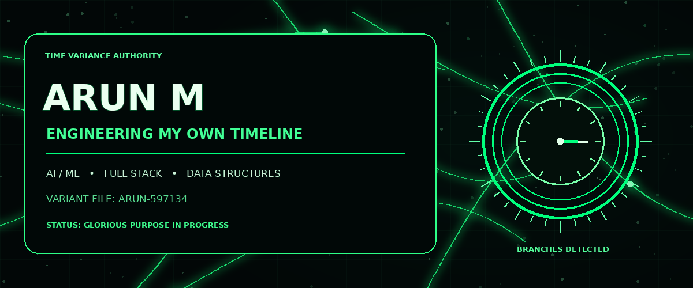
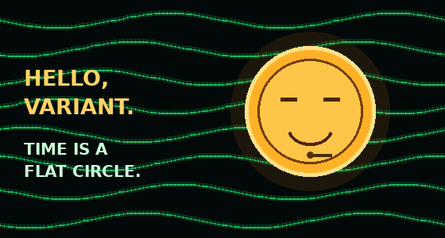

<h2>⚡ WELCOME TO MY BRANCH OF THE MULTIVERSE ⚡</h2>

<b>Final-year B.Tech Artificial Intelligence & Data Science</b> Full Stack Developer · AI/ML Engineer · Problem Solver

---

## `01 // VARIANT FILE`

> *Every choice creates a branch. I'm here to build something worth remembering across the multiverse.*

I'm Arun, a final-year **Artificial Intelligence and Data Science** student at St. Joseph's Institute of Technology, Chennai. I build full-stack products and AI-powered applications across civic-tech, EdTech, and developer tools.

- 🎓 **Degree:** B.Tech — Artificial Intelligence & Data Science
- 📍 **College:** St. Joseph's Institute of Technology, Chennai
- 📊 **CGPA:** 8.21 / 10
- 🧠 **Problem solving:** 320+ LeetCode problems
- 🛠️ **Experience:** Software Development and Web Development internships

## `02 // TVA TECH ARCHIVES`

**Languages:** Python · Java · SQL  
**Web:** React.js · Flask · REST APIs · JWT · HTML · CSS · JavaScript  
**AI/ML:** Machine Learning · Deep Learning · NLP · Computer Vision · TensorFlow · scikit-learn · Random Forest  
**Data & DevOps:** PostgreSQL · MongoDB · SQLite · Pandas · NumPy · OpenCV · Docker · CI/CD · Oracle Cloud · Vercel · Render

## `03 // SIGNIFICANT TIMELINE BRANCHES`

<table>
<tr>
<td width="50%" valign="top">

### 🟢 CivicFlow AI
**AI Civic Complaint Platform**

- Full-stack platform for all 38 Tamil Nadu districts.
- CNN image classification for complaint routing.
- Reduced manual triage effort by 90%.
- Random Forest estimates resolution timelines and flags repair quotes above ₹500.

[↗ View repository](https://github.com/Arun597134/CivicflowAI)

</td>
<td width="50%" valign="top">

### 🟠 HireWise
**AI Voice Mock Interviewer**

- Python + Mistral AI API.
- Resume parsing with PyMuPDF.
- Generates role-specific interview questions.
- Real-time speech-to-text and text-to-speech.

[↗ View repository](https://github.com/AjayJ19/HireWise-AI)

</td>
</tr>
<tr>
<td width="50%" valign="top">

### 🟢 AI Online Assessment
**MERN + TensorFlow.js**

- AI-generated MCQs and timed auto-submission.
- Role-based admin and student access.
- Client-side proctoring detects face absence and tab switching.

[↗ View repository](https://github.com/Arun597134/AI-Exam-portal)

</td>
<td width="50%" valign="top">

### ⏱️ Current mission
**Build. Learn. Iterate.**

- Strengthen DSA and problem solving.
- Ship practical AI-powered web products.
- Explore reliable APIs, data systems, and deployment.

</td>
</tr>
</table>

## `04 // FIELD EXPERIENCE`

**Prodigy Infotech — Software Development Intern** · *Jul 2025 – Aug 2025*
- Built a reusable React component library used across 3+ product feature areas.
- Resolved 10+ production bugs through a peer-reviewed CI/CD pipeline.

**Codtech IT Solutions — Web Development Intern** · *Oct 2024 – Jan 2025*
- Shipped 3 responsive web pages integrated with live backend APIs.

## `05 // ACHIEVEMENT VAULT`

- 🏅 Elite NPTEL certifications from IIT Madras in Python for Data Science and Database Management Systems.
- 🌐 Selected as a MyGov Campus Ambassador for digital governance initiatives.
- 🤝 Mentored 11th- and 12th-grade students in AI/ML and Generative AI.

## `06 // MULTIVERSE ACTIVITY MONITOR`

## `07 // CONTRIBUTION SNAKE`

## `08 // OPEN A PORTAL`

  
**KEEP THE TIMELINE STABLE. KEEP BUILDING.**
 
TVA-inspired fan aesthetic · Emerald timeline branches · Timekeeper animation · Multiverse telemetry

