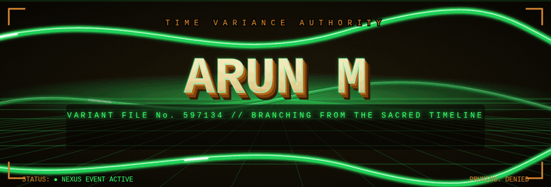
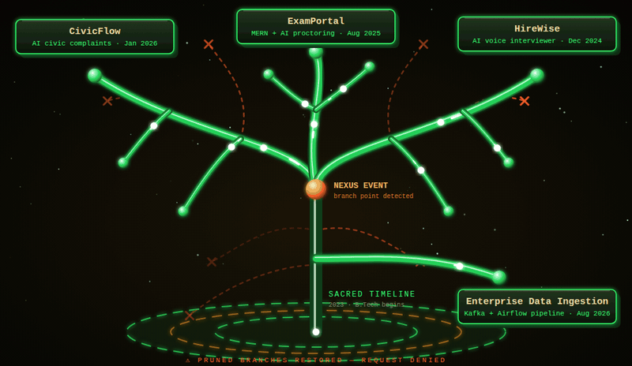
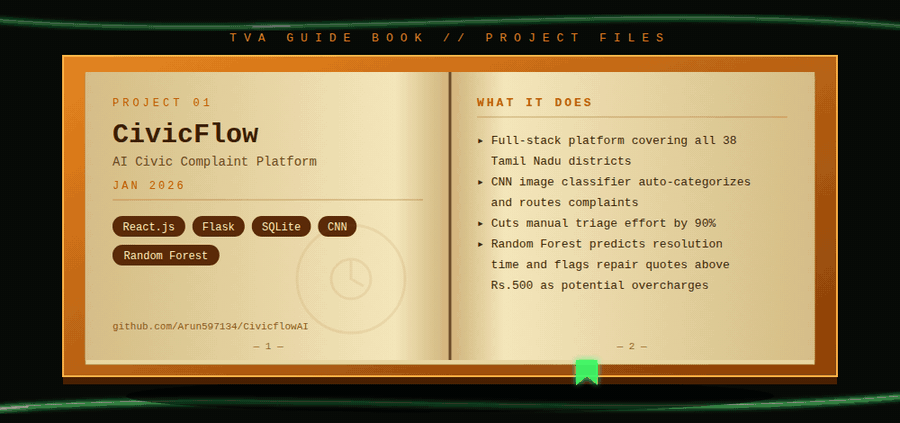
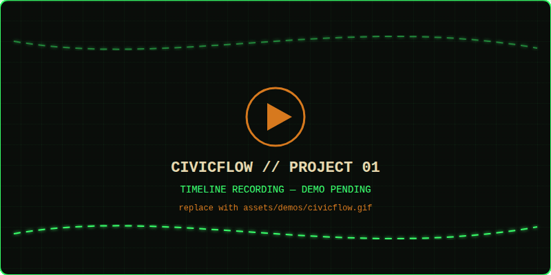
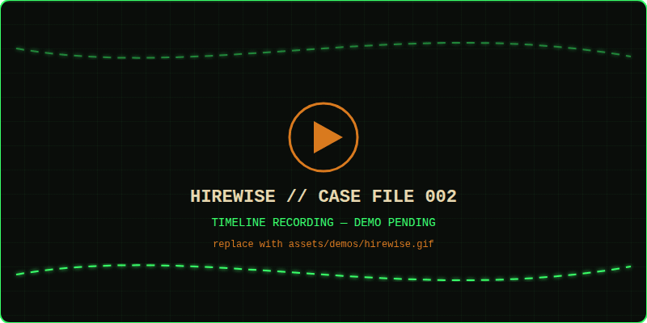
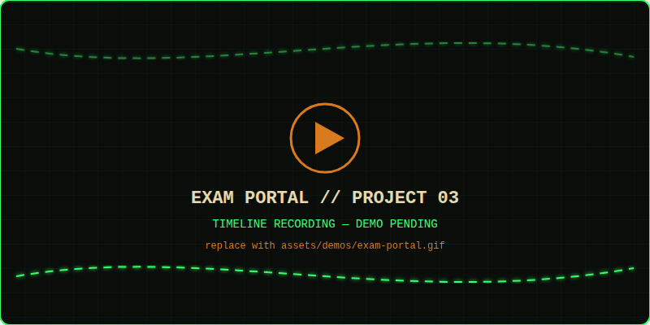
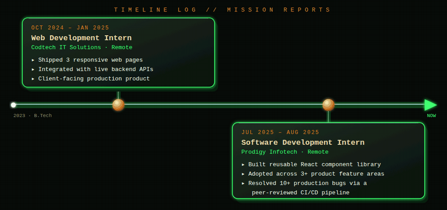
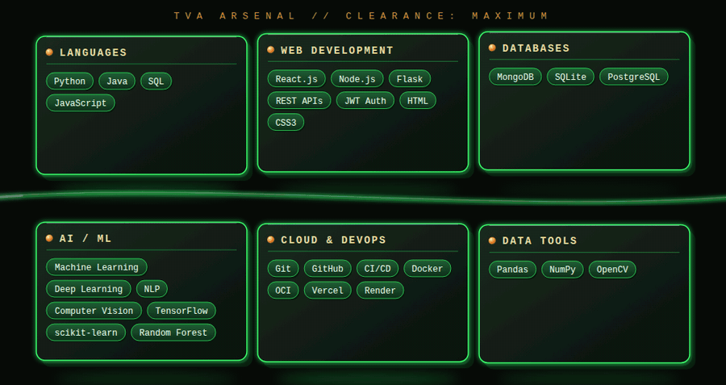
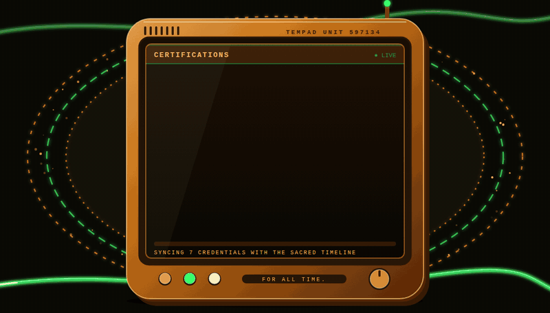

<div align="center">



<br/>


<br/><br/>

[](mailto:arun.m.dev06@gmail.com)
[](https://arun-m-portfolio.vercel.app/)
[](https://linkedin.com/in/arunvijay-5a2845317)
[](https://github.com/Arun597134)


</div>

## 📂 CASE FILE: ARUN M

```diff
+ DESIGNATION   : Final-year B.Tech, Artificial Intelligence & Data Science
+ BASE OF OPS   : St. Joseph's Institute of Technology, Chennai (CGPA 8.21)
+ SPECIALITY    : Full Stack Development • AI/ML • REST APIs • DSA
+ TIMELINE SCAN : 2 internships • 3 shipped projects • 320+ LeetCode problems
+ AFFILIATION   : MyGov Campus Ambassador (Govt. of India, digital governance)
+ MENTORSHIP    : 2+ batches of 11th/12th students in AI/ML & Generative AI
- THREAT LEVEL  : Dangerously productive. Pruning not recommended.
```

<div align="center"></div>

## 🌌 THE MULTIVERSE: MY PROJECT BRANCHES

<div align="center">

</div>

<div align="center"></div>

## 📘 TVA GUIDE BOOK: MY PROJECTS

<div align="center">

</div>

### 🟢 PROJECT 01: CivicFlow

<div align="center">
<a href="https://github.com/Arun597134/CivicflowAI"></a>
</div>

AI civic complaint platform for all 38 Tamil Nadu districts. 🔗 [**View project →**](https://github.com/Arun597134/CivicflowAI)

---

### 🟢 PROJECT 02: HireWise

<div align="center">
<a href="https://github.com/AjayJ19/HireWise-AI"></a>
</div>

AI voice mock interviewer with resume parsing and speech pipelines. 🔗 [**View project →**](https://github.com/AjayJ19/HireWise-AI)

---

### 🟢 PROJECT 03: AI Online Assessment Platform

<div align="center">
<a href="https://github.com/Arun597134/AI-Exam-portal"></a>
</div>

MERN exam platform with AI-generated MCQs and TensorFlow.js proctoring. 🔗 [**View project →**](https://github.com/Arun597134/AI-Exam-portal)

<div align="center"></div>

## 🕰️ TIMELINE LOG: EXPERIENCE

<div align="center">

</div>

<div align="center"></div>

## 🛠️ TVA ARSENAL: TECH STACK

<div align="center">

</div>

<div align="center"></div>

## 📊 TIMELINE ACTIVITY MONITOR

<div align="center">


</div>

## 🐍 TEMPORAL SNAKE: CONTRIBUTIONS

<div align="center">


</div>

<div align="center"></div>

## 🏆 ACHIEVEMENTS & CERTIFICATIONS

- 🧩 Solved **320+ LeetCode** problems (arrays, strings, trees, graphs, DP)
- 🇮🇳 Selected as **MyGov Campus Ambassador** for Govt. of India's digital governance initiatives
- 🎓 **9+ certifications** by 2nd year, including **2 Elite NPTEL certs from IIT Madras**
- 👨‍🏫 Mentored **2+ batches** of 11th/12th students on AI/ML & Generative AI

### 🪪 CERTIFICATIONS

<div align="center">

</div>

<div align="center">


### ✉️ OPEN A PORTAL TO ME

**Looking for internships and full-time roles in Full Stack and AI/ML.**

[](mailto:arun.m.dev06@gmail.com)
[](https://arun-m-portfolio.vercel.app/)


<sub>Fan-made tribute theme. Not affiliated with Marvel or Disney.</sub>

</div>
